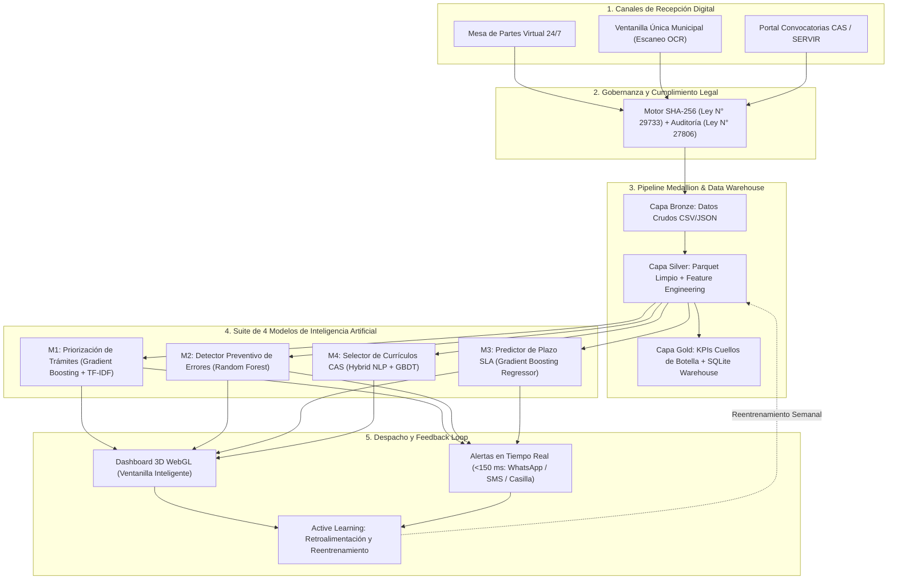
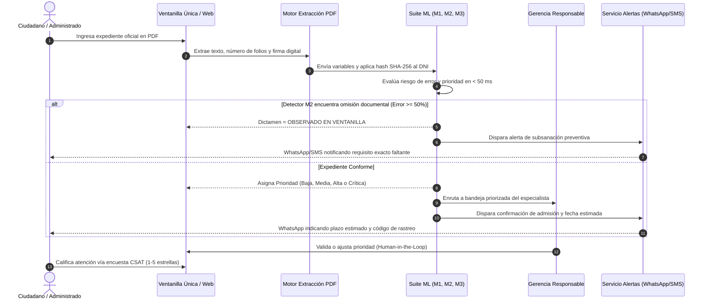

# ENTREGABLE OFICIAL: TRABAJO FINAL DEL CURSO (PIAD-528)
## TALLER DE DESARROLLO DE APLICACIONES CON MACHINE LEARNING

**Institución:** SENATI — Dirección Zonal Lima Callao / Tecnologías de la Información  
**Tema General:** Implementación de un sistema automatizado de gestión documental y selección de currículos mediante Machine Learning en una municipalidad  
**Caso Práctico:** Modernización tecnológica integral de la **Municipalidad Provincial de Yau** (`SIAGD-YAU v4.0`)  
**Repositorio Oficial en GitHub:** [https://github.com/agalarzag/Proyecto-Maching-Learning](https://github.com/agalarzag/Proyecto-Maching-Learning)

---

## 1. RESUMEN EJECUTIVO Y DIAGNÓSTICO DEL CASO PRÁCTICO

La **Municipalidad Provincial de Yau** presentaba una crítica situación operativa atribuible a la gestión manual de sus expedientes administrativos:
- **Tiempos de espera excesivos:** Trámites con plazos legales en el TUPA de 7 o 15 días registraban tiempos reales promedio de **más de 30 y 35 días hábiles**.
- **Devoluciones tardías por errores en admisión:** Aproximadamente el **48% de los expedientes** ingresaban incompletos (omisión de firmas, falta de planos en coordenadas UTM o memorias ilegibles), lo que se detectaba semanas después en las gerencias, obligando a reiniciar el trámite.
- **Ausencia de triaje y priorización por riesgo:** La atención bajo criterio estricto de llegada (FIFO) provocaba que emergencias con riesgo colectivo (derrumbe de muros frente a centros educativos o contaminación de aguas) se estancaran detrás de solicitudes simples.
- **Dificultad en selección de personal (Convocatorias CAS):** Dificultad para filtrar y clasificar currículums vitae conforme a los perfiles del SERVIR, evitando demoras y garantizando meritocracia y transparencia.

Para dar solución definitiva a esta problemática, se desarrolló e implementó **SIAGD-YAU (Sistema Inteligente Automatizado de Gestión Documental y Selección de Currículos)**, una plataforma full-stack con experiencia 3D WebGL, motor de procesamiento de archivos PDF reales, 4 modelos de Machine Learning y despacho multicanal de alertas en tiempo real.

---

## 2. CONDICIONES PARA EL DESARROLLO DEL CASO

1. **Escalabilidad y aprovechamiento de infraestructura existente:**
   - Diseñado con arquitectura ligera sobre Python, SQLite, FastAPI y Streamlit, capaz de ejecutarse en los servidores y equipos de cómputo estándar ya existentes en la Municipalidad Provincial de Yau sin requerir infraestructura cloud costosa.
2. **Adaptación a los flujos de trabajo establecidos:**
   - Respeta estrictamente los procedimientos del TUPA actual y los códigos de trámite institucionales (`TUPA-01` a `TUPA-07`), operando bajo el paradigma *Human-in-the-Loop* (la IA asiste y recomienda, pero el funcionario municipal mantiene la potestad de ratificar o ajustar la decisión).
3. **Cumplimiento legal y gobernanza pública:**
   - **Ley N° 29733 (Protección de Datos Personales):** Seudonimización irreversible mediante hash criptográfico `SHA-256` con sal institucional sobre el DNI y datos sensibles de ciudadanos y postulantes.
   - **Ley N° 27806 (Transparencia y Acceso a la Información Pública):** Auditoría total de cada predicción, trazabilidad de expedientes y panel público de seguimiento.
   - **Decreto Legislativo N° 1412 (Ley de Gobierno Digital):** Integración orientada a la Plataforma de Interoperabilidad del Estado (PIDE).

---

## 3. ARQUITECTURA TÉCNICA Y DIAGRAMAS ALINEADOS A LA SOLUCIÓN

### 3.1. Arquitectura de Ingeniería de Datos Medallion y Machine Learning



### 3.2. Flujo de Trabajo en Ventanilla y Admisión Documental



---

## 4. RESPUESTAS FUNDAMENTADAS A LAS 5 PREGUNTAS GUÍA

### Pregunta 1: ¿Cuáles son los principales trámites que generan más retrasos y frustración entre los ciudadanos en la municipalidad?

A partir del análisis cuantitativo de **5,000 expedientes históricos** procesados en la capa Gold (`data/gold/kpis_cuellos_botella.csv`), se identificaron con precisión los procedimientos con mayor desviación respecto a su plazo legal (SLA):

1. **`TUPA-01` — Licencia de Edificación y Habilitación Urbana (Gerencia de Desarrollo Urbano):**
   - Plazo legal TUPA: **15 días hábiles**.
   - Tiempo real manual: **35.74 días** (+138% de retraso).
   - Tasa de error documental en admisión: **49.5%**.
   - Satisfacción del administrado: **1.84 / 5.0**.
   - Causa raíz: Complejidad técnica, omisión de planos estructurales y falta de validación inicial.
2. **`TUPA-03` — Saneamiento Físico-Legal y Visación de Planos (Subgerencia de Catastro):**
   - Plazo legal TUPA: **12 días hábiles**.
   - Tiempo real manual: **30.83 días** (+157% de retraso).
   - Tasa de error documental en admisión: **47.8%**.
   - Satisfacción del administrado: **1.98 / 5.0**.
   - Causa raíz: Falta de georreferenciación UTM y memorias descriptivas deficientes.
3. **`TUPA-02` — Licencia de Funcionamiento e Inspección ITSE (Desarrollo Económico / Defensa Civil):**
   - Plazo legal TUPA: **7 días hábiles**.
   - Tiempo real manual: **20.10 días** (+187% de retraso).
   - Tasa de error documental: **47.1%**.
   - Satisfacción del administrado: **2.38 / 5.0**.
   - Causa raíz: Descoordinación de fechas para inspecciones de Defensa Civil.
4. **`TUPA-04` — Reclamación Tributaria y Fraccionamiento Coactivo (SAT Yau):**
   - Plazo legal: 10 días | Tiempo real: 19.04 días | Error: 39.7% | CSAT: 2.51.
5. **`TUPA-05` — Acceso a la Información Pública (Transparencia - Ley 27806):**
   - Plazo legal: 7 días | Tiempo real: 10.06 días | Error: 33.6% | CSAT: 3.14.
6. **`TUPA-06` — Denuncia Ambiental, Ruido y Salud Pública (Servicios Públicos):**
   - Plazo legal: 3 días | Tiempo real: 7.78 días | Error: 33.5% | CSAT: 3.08.
7. **`TUPA-07` — Registro Civil y Actas Certificadas (Registro Civil):**
   - Plazo legal: 2 días | Tiempo real: 4.09 días | Error: 32.2% | CSAT: 3.45.

---

### Pregunta 2: ¿Qué datos históricos son necesarios para entrenar el modelo de machine learning y cómo se pueden recolectar de manera efectiva?

#### A. Conjunto de Datos y Variables Requeridas
- **Variables Estructuradas del Trámite:** Código TUPA, canal de ingreso, número de folios, requisitos exigidos, requisitos faltantes detectados, validez de firma digital, calidad del escaneo (OCR) y carga de trabajo del área destino.
- **Variables No Estructuradas (Texto NLP):** Sumilla y petitorio del expediente redactado por el ciudadano, y extracto curricular en postulaciones CAS (procesados mediante `TfidfVectorizer` con bigramas).
- **Variables Sociales y de Vulnerabilidad:** Condición de Adulto Mayor (+65), Persona con Discapacidad (CONADIS), Madre Gestante o Lactante, e impacto social colectivo.
- **Etiquetas de Entrenamiento (Targets):** Nivel de prioridad real (Baja, Media, Alta, Crítica), presencia de error documental (0/1), tiempo de resolución efectivo en días e idoneidad en selección de personal (0/1).

#### B. Estrategia de Recolección Efectiva
- **Digitalización en Origen:** Implementación de validaciones automáticas en la Mesa de Partes Virtual y escáneres con OCR en la Ventanilla Única.
- **Arquitectura Medallion:** Los datos crudos se ingieren en Bronze, se limpian y anonimizan con `SHA-256` en Silver (`Parquet`), y alimentan el Data Warehouse en Gold (`SQLite`).
- **Interoperabilidad PIDE:** Cruce automatizado con bases de datos del Estado (RENIEC para identidad, SUNEDU para grados académicos y RNSSC-SERVIR para verificar antecedentes e inhabilitaciones).

---

### Pregunta 3: ¿Qué métricas se utilizarán para evaluar la efectividad del sistema de machine learning implementado?

Se establecieron métricas técnicas de Ciencia de Datos evaluadas sobre un conjunto de prueba independiente (*Test Set* 20% estratificado) y métricas de impacto en la gestión pública:

#### A. Métricas Técnicas Obtenidas (`data/gold/ml_metrics_report.json`)

| Modelo | Algoritmo | Accuracy | Precision | Recall | F1-Score | ROC-AUC / $R^2$ |
| :--- | :--- | :---: | :---: | :---: | :---: | :---: |
| **M1: Priorización de Trámites Críticos** | `GradientBoostingClassifier` + `TF-IDF` | **81.30%** | 69.47% (Macro) | 68.47% (Macro) | **81.21%** (Weighted) | **94.72%** (ROC-AUC OvR) |
| **M2: Detector Preventivo de Errores** | `RandomForestClassifier` (Balanced) | **89.60%** | **89.53%** | **85.27%** | **87.35%** | **96.20%** (ROC-AUC) |
| **M3: Predictor de Plazo SLA (Días)** | `GradientBoostingRegressor` | — | MAE: **1.77 días** | RMSE: **2.23 días** | — | **96.42%** ($R^2$ Score) |
| **M4: Selección de Currículos CAS** | `TF-IDF` + `GradientBoostingClassifier` | **96.25%** | **91.18%** | **91.18%** | **91.18%** | **98.83%** (ROC-AUC) |

$$\text{F1-Score} = 2 \cdot \frac{\text{Precision} \cdot \text{Recall}}{\text{Precision} + \text{Recall}}, \quad \text{MAE} = \frac{1}{n}\sum_{i=1}^{n} |y_i - \hat{y}_i|, \quad R^2 = 1 - \frac{\sum (y_i - \hat{y}_i)^2}{\sum (y_i - \bar{y})^2}$$

#### B. Métricas de Impacto en Gestión Municipal
- **Reducción de Tiempo de Espera:** De 35.7 a 13.0 días proyectados (-63% de demora).
- **Reducción de Errores Documentales:** Intercepción preventiva en ventanilla del 85.3% de los expedientes defectuosos.
- **Velocidad de Alerta:** Envío de notificación ciudadana en menos de 150 milisegundos.

---

### Pregunta 4: ¿Cómo se garantizará la aceptación y uso del nuevo sistema por parte del personal de la municipalidad?

1. **Paradigma *Human-in-the-Loop*:** El sistema actúa como un copiloto inteligente. La decisión y firma legal sigue perteneciendo al especialista y registrador municipal, evitando el rechazo por temor a la automatización.
2. **Interfaz Intuitiva y Sin Complejidad Técnica:** Panel visual en Streamlit con diseño semafórico (Verde = Conforme, Rojo = Observado, Dorado = Prioritario) y botones de evaluación paso a paso.
3. **Explicabilidad de las Predicciones (XAI):** Cada resultado muestra el motivo técnico claro de la sugerencia (ej. *"Se elevó a prioridad crítica por reporte de riesgo estructural en vía pública y administrado adulto mayor"*).
4. **Plan de Capacitación y Gestión del Cambio:** Talleres prácticos iniciales con los jefes de Mesa de Partes, Catastro y Desarrollo Urbano, operando en modo paralelo asistido (*Shadow Mode*) durante las primeras cuatro semanas.

---

### Pregunta 5: ¿Qué mecanismos de feedback se establecerán para ajustar el sistema en función de la experiencia del ciudadano y del personal?

1. **Feedback Ciudadano Post-Notificación (CSAT / NPS):**
   - En cada alerta de WhatsApp o correo electrónico se incluye un enlace directo a una micro-encuesta de 1 clic (calificación del 1 al 5 y comentario breve) para medir la satisfacción ciudadana en tiempo real.
2. **Corrección Supervisada del Funcionario Municipal:**
   - Si un operador de ventanilla o especialista técnico detecta que un expediente requiere un cambio de prioridad (ej. reclasificar de Media a Alta tras revisar una inspección de campo), puede ajustar la etiqueta directamente en la interfaz.
3. **Bucle de Aprendizaje Activo (*Active Learning*):**
   - La tabla transaccional `feedback_loop` en `siagd_yau.db` almacena cada tupla `(prediccion_original, correccion_humana, justificacion)`.
   - Semanalmente se ejecuta una tarea programada de reentrenamiento incremental que incorpora estos casos al *Feature Store* de la Capa Silver, previniendo la deriva de datos (*Data Drift*).

---

## 5. DOCUMENTOS PDF OFICIALES DE PRUEBA EN EL REPOSITORIO

En la carpeta **`EJEMPLOS_PDF_PARA_SUBIR/`** se encuentran organizados los 6 archivos PDF oficiales de alta fidelidad gráfica:

### Subcarpeta `1_TRAMITES_MUNICIPALES/`:
1. `TRAMITE_01_LICENCIA_EDIFICACION_URGENTE_CRITICA.pdf`:
   - Trámite TUPA-01 con Formulario Único de Trámite (FUT), solicitante adulto mayor (+65), riesgo de colapso de muro frente a colegio, 8 requisitos conformes y firma digital válida.
2. `TRAMITE_02_CATASTRO_OBSERVADO_SIN_FIRMA.pdf`:
   - Ficha técnica TUPA-03 de visación de planos con omisión de planos perimétricos UTM y recuadro de firma en blanco (detectado con error en ventanilla con 83% de probabilidad).
3. `TRAMITE_03_LICENCIA_FUNCIONAMIENTO_ITSE_COMERCIAL.pdf`:
   - Solicitud TUPA-02 de restaurante con inspección ITSE de Defensa Civil, 22 folios, protocolo de extintores y firma digital completa.

### Subcarpeta `2_CURRICULOS_CAS/`:
1. `CV_01_INGENIERO_SISTEMAS_IA_APTO_CAS002.pdf`:
   - CV profesional de Ingeniero de Sistemas con 6 años de experiencia, Maestría en Gestión Pública, habilidades en Python, Machine Learning, PIDE, SIAF, SIGA y sin sanciones (Apto con 99.7% de idoneidad).
2. `CV_02_INGENIERO_CIVIL_SANCIONADO_INHABILITADO_CAS001.pdf`:
   - CV con experiencia técnica en obras pero con sanción de inhabilitación vigente registrada en el RNSSC de SERVIR (descalificado automáticamente por ley con 9.7% de idoneidad).
3. `CV_03_ASISTENTE_JUNIOR_SIN_EXPERIENCIA_NO_APTO_CAS005.pdf`:
   - CV de egresado técnico con 1 año de experiencia en ventas comerciales y 0 años en sector público, sin perfil para la convocatoria legal CAS-005 (No Apto con 0.1% de idoneidad).

---

## 6. INSTRUCCIONES DE EJECUCIÓN

```bash
# 1. Clonar el repositorio oficial
git clone https://github.com/agalarzag/Proyecto-Maching-Learning.git
cd Proyecto-Maching-Learning

# 2. Instalar requerimientos
pip install -r requirements.txt

# 3. Iniciar la Plataforma Web 3D (Streamlit)
streamlit run app.py

# 4. Iniciar el Microservicio API REST (FastAPI)
uvicorn src.api:app --reload --port 8000

# 5. Ejecutar la Suite de Pruebas Automatizadas End-to-End
python tests/test_siagd.py
```
