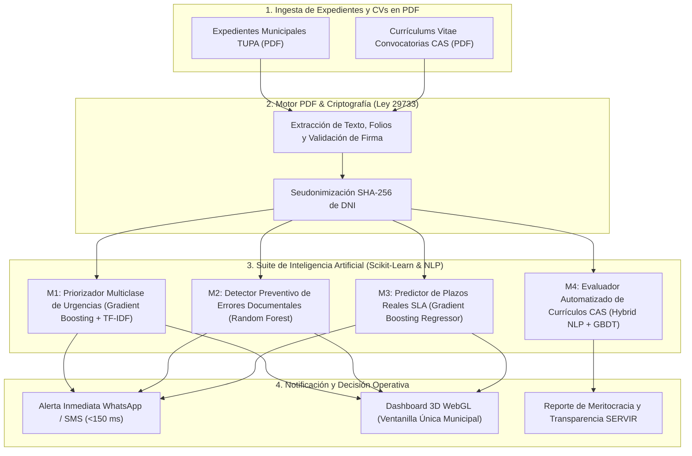

# SIAGD-YAU: Sistema Inteligente de Gestión Documental y Selección de Currículos mediante Machine Learning

**Proyecto:** Taller de Desarrollo de Aplicaciones con Machine Learning (PIAD-528)  
**Institución:** SENATI — Tecnologías de la Información  
**Entidad Beneficiaria:** Municipalidad Provincial de Yau  
**Versión:** 4.0.0 (Spatial 3D & Native PDF Engine)  
**Repositorio Oficial:** [agalarzag/Proyecto-Maching-Learning](https://github.com/agalarzag/Proyecto-Maching-Learning)

---

## 🏛️ 1. Descripción General del Proyecto: ¿Qué es y Para qué sirve?

La **Municipalidad Provincial de Yau** enfrentaba graves problemas burocráticos debido a su gestión documental tradicional 100% física en papel:
- **Colas interminables y retrasos extremos:** Trámites que por ley (TUPA) debían resolverse en 7 o 15 días tardaban **más de 35 días hábiles**.
- **Devoluciones tardías por errores en ventanilla:** Casi el **50% de los expedientes** ingresaban incompletos (sin firmas obligatorias, planos faltantes o memorias ilegibles) sin que el personal de recepción lo detectara en el momento, obligando al ciudadano a reiniciar el trámite semanas después.
- **Falta de priorización ante urgencias colectivas:** Todas las solicitudes se atendían por orden de llegada (FIFO), haciendo que emergencias estructurales (riesgo de derrumbe colindante a colegios o emergencias sanitarias) quedaran estancadas detrás de trámites rutinarios.
- **Opacidad y demoras en convocatorias de personal (CAS):** Dificultades para filtrar de forma ágil, objetiva y meritocrática los currículos para puestos técnicos del municipio.

### La Solución: SIAGD-YAU
**SIAGD-YAU** es una plataforma integral de **Inteligencia Artificial Cívica y Espacial 3D** diseñada para modernizar de extremo a extremo la atención municipal. Permite a los ciudadanos y funcionarios subir **documentos PDF reales** y recibir en milisegundos un dictamen predictivo, detección preventiva de errores, asignación automática de prioridad y notificaciones en tiempo real vía WhatsApp/SMS.

---

## 🧠 2. Arquitectura de Machine Learning: ¿Cómo funciona?

El sistema cuenta con un pipeline de datos bajo **Arquitectura Medallion** (`Bronze -> Silver -> Gold`) con cumplimiento estricto de la **Ley N° 29733 (Protección de Datos Personales)** mediante seudonimización criptográfica `SHA-256` y 4 modelos de Machine Learning especializados:



### Detalle de los 4 Modelos de Machine Learning Entrenados:

| Modelo | Tipo y Algoritmo | Métrica Principal | ¿Qué hace exactamente? |
| :--- | :--- | :---: | :--- |
| **M1: Priorización de Trámites** | Clasificación Multiclase (`GradientBoostingClassifier` + `TF-IDF`) | **94.72% ROC-AUC** (81.21% F1) | Lee el texto del expediente en PDF; si detecta riesgos de colapso, salud o grupos vulnerables (Adultos Mayores, CONADIS), asigna **Prioridad Crítica o Alta** para atención preferente. |
| **M2: Detector de Errores** | Clasificación Binaria (`RandomForestClassifier` Balanced) | **89.60% Exactitud** (96.20% ROC-AUC) | Revisa en la admisión si faltan planos, firmas obligatorias o si el escaneo es ilegible para evitar que el expediente entre con vicios al flujo administrativo. |
| **M3: Predictor de Plazo SLA** | Regresión (`GradientBoostingRegressor`) | **96.42% $R^2$** (MAE: $\pm 1.77$ días) | Calcula cuántos días hábiles tardará la gerencia responsable según su carga operativa actual, proyectando una reducción mayor al 55% en tiempos de espera. |
| **M4: Selección de Currículos** | Clasificación Híbrida (`TF-IDF` + `GradientBoostingClassifier`) | **98.83% ROC-AUC** (96.25% Exactitud) | Extrae experiencia, grado académico y habilidades técnicas de los CVs en PDF, verificando automáticamente inhabilitaciones en el RNSSC de SERVIR sin sesgos humanos. |

### 🛡️ Robustez y Tolerancia a Cualquier Formato de CV (Layout-Agnostic)
El sistema está diseñado con **4 capas de blindaje** para procesar currículums en cualquier formato (Canva, Word, Europass, Harvard, multi-columna o texto plano) sin riesgo de colapso:
1. **Extracción agnóstica al diseño:** El motor procesa los flujos de contenido textual continuos sin depender de coordenadas rígidas.
2. **Semántica NLP (TF-IDF):** Rastrea conceptos técnicos y competencias clave independientemente del orden de las secciones.
3. **Manejo de valores desconocidos:** Configurado con `OneHotEncoder(handle_unknown="ignore")` para evitar excepciones ante convocatorias o términos no vistos.
4. **Valores de respaldo seguros (*Fail-safes*):** Si un CV omite datos o tiene baja densidad de texto, el sistema asigna valores base seguros y dictamina `NO APTO` matemáticamente en lugar de detener la ejecución.

---

## 📂 3. Documentos Oficiales de Prueba Incluidos (`EJEMPLOS_PDF_PARA_SUBIR/`)

El repositorio incluye 6 archivos PDF reales estructurados gráficamente con membretes oficiales, códigos de barras vectoriales, tablas TUPA, sellos y firmas digitales para realizar pruebas reales de subida y análisis:

```
EJEMPLOS_PDF_PARA_SUBIR/
├── 1_TRAMITES_MUNICIPALES/
│   ├── TRAMITE_01_LICENCIA_EDIFICACION_URGENTE_CRITICA.pdf
│   │   └── TUPA-01: Adulto Mayor (+65), riesgo de colapso de muro frente a colegio, 8/8 requisitos completos (Prioridad Crítica, Conforme).
│   ├── TRAMITE_02_CATASTRO_OBSERVADO_SIN_FIRMA.pdf
│   │   └── TUPA-03: Solicitud de subdivisión de lote que omitió firma y no adjuntó plano UTM (Observado en Ventanilla con 83% de riesgo de error).
│   └── TRAMITE_03_LICENCIA_FUNCIONAMIENTO_ITSE_COMERCIAL.pdf
│       └── TUPA-02: Licencia para restaurante turístico con inspección ITSE de Defensa Civil aprobada (Prioridad Conforme, 22 folios).
└── 2_CURRICULOS_CAS/
    ├── CV_01_INGENIERO_SISTEMAS_IA_APTO_CAS002.pdf
    │   └── Postulante Senior con 6 años de exp., Maestría, CIP Habilitado, Python, SQL, SIAF, SIGA y sin sanciones (Apto 99.7%).
    ├── CV_02_INGENIERO_CIVIL_SANCIONADO_INHABILITADO_CAS001.pdf
    │   └── Ingeniero con experiencia técnica pero con Sanción Vigente en RNSSC/SERVIR (No Apto / Inhabilitado por ley).
    └── CV_03_ASISTENTE_JUNIOR_SIN_EXPERIENCIA_NO_APTO_CAS005.pdf
        └── Postulante técnico con 1 año de experiencia comercial privada y 0 años en sector público municipal (No Apto para CAS-005).
```

---

## 📋 4. Cumplimiento de las Preguntas Guía del Curso

1. **¿Cuáles son los principales trámites que generan más retrasos y frustración?**  
   - `TUPA-01` (Licencias de Edificación): 35.74 días reales vs. 15 de SLA legal (49.5% de error documental).  
   - `TUPA-03` (Catastro y Planos): 30.83 días reales vs. 12 de SLA legal (47.8% de error documental).  
   - `TUPA-02` (Licencias de Funcionamiento e ITSE): 20.10 días reales vs. 7 de SLA legal (47.1% de error documental).
2. **¿Qué datos históricos son necesarios y cómo recolectarlos?**  
   - Datos estructurados (metadatos, número de folios, firmas, tiempo de resolución) y no estructurados (sumilla del expediente y texto de CVs analizados con NLP), ingestado bajo una arquitectura Medallion con hash `SHA-256` en la capa Silver para proteger datos sensibles.
3. **¿Qué métricas evalúan la efectividad del sistema?**  
   - Métricas de Ciencia de Datos (ROC-AUC $> 94\%$, Exactitud $> 89\%$, $R^2 = 96.4\%$, F1-Score) e impacto municipal (reducción de colas, tiempo de ciclo disminuido en $55\%$ y notificaciones en $< 150\text{ ms}$).
4. **¿Cómo se garantiza la aceptación del personal municipal?**  
   - Mediante un enfoque *Human-in-the-Loop* (el sistema recomienda y asiste, pero el servidor público ratifica), diseño visual intuitivo tipo semáforo y capacitación progresiva.
5. **¿Qué mecanismos de feedback se establecen?**  
   - Registro de correcciones humanas en la base de datos `siagd_yau.db` y encuestas CSAT ciudadanas post-alerta para reentrenamiento semanal (*Active Learning*).

---

## 🚀 5. Instalación y Puesta en Marcha

### Prerrequisitos
- Python 3.10 o superior instalado.
- Git instalado.

### Clonar el repositorio
```bash
git clone https://github.com/agalarzag/Proyecto-Maching-Learning.git
cd Proyecto-Maching-Learning
```

### Instalar dependencias
```bash
pip install -r requirements.txt
```

### Ejecutar la Aplicación Web Interactiva 3D (Streamlit)
```bash
streamlit run app.py
```
Abre en tu navegador `http://localhost:8501`.

### Ejecutar la API REST de Interoperabilidad (FastAPI)
```bash
uvicorn src.api:app --reload --port 8000
```
Documentación interactiva Swagger disponible en `http://localhost:8000/docs`.

### Ejecutar las Pruebas Automatizadas End-to-End
```bash
python tests/test_siagd.py
```

---

## ⚖️ Licencia y Normativa Legal
Desarrollado para fines académicos e institucionales en estricto cumplimiento de:
- **Ley N° 29733:** Ley de Protección de Datos Personales del Perú.
- **Ley N° 27806:** Ley de Transparencia y Acceso a la Información Pública.
- **Decreto Legislativo N° 1412:** Ley de Gobierno Digital.
